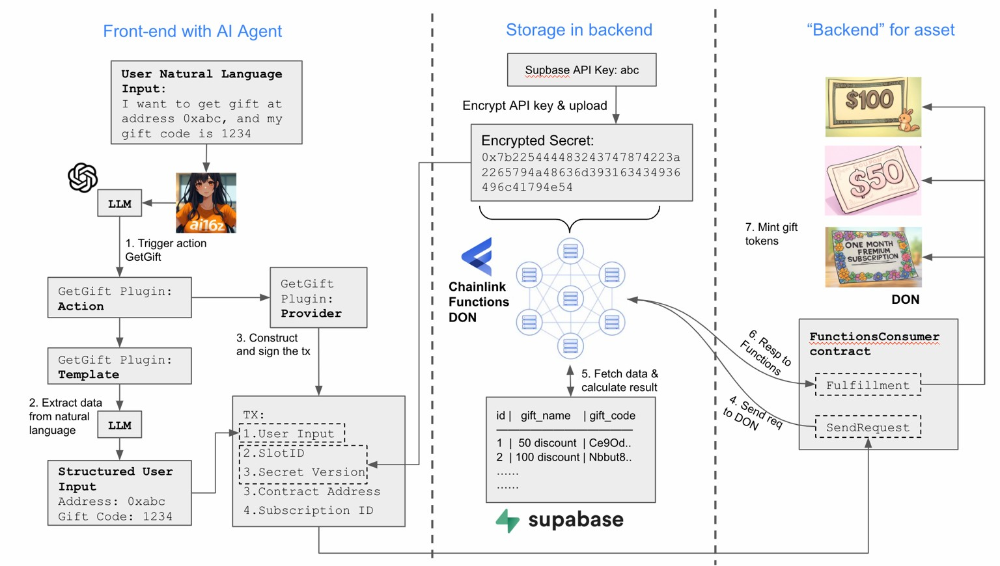

# Intellichain 🔗✨

**Turn a tweet into a real onchain gift: an AI agent parses the reply, a decentralized oracle verifies the claim, and a hardened contract mints the NFT — nobody holds the database, and the agent never guesses.**

> Open-source portfolio project: the interesting half isn't the Solidity — it's an LLM agent that is deliberately wired so it **cannot hallucinate a claim**.

[](https://github.com/abdulsamed1/Intellichain/actions/workflows/ci.yml)


## 💡 What this is

Users reply to a tweet with a gift code and their wallet. **GiftPilot** — an
[elizaOS](https://github.com/elizaOS/eliza) agent — reads the reply, a
[Chainlink Functions](https://functions.chain.link/) DON checks the code against a
Supabase table inside trusted execution, and the `GetGift` contract mints an
ERC-721 gift straight to the claimed wallet. Relayer key, model key, database
credentials, Twitter login — every private thing arrives via local `.env`
files only and stays there.

> ⚠️ **This is un-audited code, derived from Chainlink's example contracts.**
> Do not use it in production without a professional audit.

## ⚡ Why it's interesting to AI engineers

Most "AI meets blockchain" demos let a language model read a message and act
on it directly. GiftPilot is built different: **the model picks the moment,
the code picks the truth.** The LLM's only job inside the claim path is
deciding *when* the `GET_GIFT` action applies; the claim *data* is extracted
deterministically, validated, and enforced by contract-shaped rejections.

- **Data decisions are never LLM-made.** `extraction.ts` finds address
  *shapes* with strict boundaries, validates them against **EIP-55
  checksums**, masks every `0x…` hex run so a transaction hash can never
  shrink into a pseudo-address, then scans for a code token (5–32 chars,
  at least one digit). Pinned by unit tests — the review focus was
  *"never mint the wrong pair."*
- **Candidate-aware clarification.** If the message is inexact, GiftPilot
  asks for **exactly the missing piece** (only the code, or only the
  address) — zero model tokens spent on structured data.
- **A contract-literate agent.** `mapContractError` translates `GetGift`
  custom errors (`CodeAlreadyRedeemed`, `RequestAlreadyInFlight`,
  `CallerNotAllowlisted`, `InvalidRecipient`, …) into conversational
  replies. The agent speaks the ABI instead of dumping revert blobs.
- **Receipt-gated truth-telling.** The claim submission awaits the
  transaction **receipt** before the fulfillment poll ladder may tick;
  the monitor races event-watchers against a `giftCodeRedeemed` poll
  (first-settled wins) and reports **minted / released / still watching** —
  never a premature "done" while the transaction is still flying.
- **Fail-fast, secret-hygienic boot.** A zod-validated env gate refuses
  half-configured boots *and* dangerous combinations (a live network with
  `FUNCTIONS_SECRET_VERSION=0` — which silently burns LINK — is rejected
  with the fix in the error message). Model keys are injected into an
  in-memory character clone; the boot log prints character **names only**.
- **Bring your own brain — including free.** Model keys resolve
  `OPENAI_API_KEY` → `OPENROUTER_API_KEY` → `CLOUD`, with an
  `OPENAI_API_URL` passthrough to any OpenAI-compatible endpoint. The
  documented free route is [**FreeLLMAPI**](https://github.com/abdulsamed1/freellmapi):
  one `/v1` router aggregating free provider tiers, with per-size pins like
  `auto:fast` / `auto` / `auto:smart`.

### The thread you'd actually see

Reply text is rendered by the exact pure, offline-tested builders (sample
values shown):

> **user:** @GiftPilotBot SUPERGIFT777 for gifting to 0xAb5801a7D398351b8bE11C439e05C5B3259aeC9B
>
> **GiftPilot:** Your claim for code "SUPERGIFT777" is submitted onchain (tx `0x…`).
> I'm watching the fulfillment now and will reply here as soon as it settles — usually within a minute.
>
> **GiftPilot:** 🎉 Minted! Your gift ("Gold Membership", token #42) is in your wallet.
> Thanks for claiming "SUPERGIFT777"!

And when the oracle couldn't complete, it says so and the code goes back to
the pool: **"not minted — contract released the code; nothing was spent,
retry anytime."** A slow fulfillment is reported as *still watching*, never
as a failure. The agent tells the truth about degraded paths because the
monitor engineers them in: released codes are proven by event **or** by the
post-shield poll, and a mint settles the answer permanently.

## 🏗️ How it works



1. **User tweet reply** — wallet address + claim code.
2. **AI agent (elizaOS)** — deterministic extraction (EIP-55 + code mask),
   clarify-ask when inexact.
3. **Chainlink Functions DON** — runs the claim-check JavaScript in a
   trusted execution environment: calls Supabase, verifies the code exists
   and is unused, returns the gift type.
4. **`GetGift` contract (Sepolia)** — receives the signed oracle result and
   mints the mapped gift NFT.
5. **User receives the gift** — the NFT (with IPFS metadata) lands in the
   claimed wallet; the agent reports the settled outcome in the same thread.

## 🧭 The agent in one screen

```
tweet mention ──▶ vendored twitter client (interactions.ts)
                     │  elizaOS message pipeline (who/when = LLM)
                     ▼
               GET_GIFT action  ── data decisions are DETERMINISTIC ──
                     │            extractClaim(): EIP-55 address + masked code
                     │  inexact  → clarifyReply() (asks for the missing piece)
                     ▼
             GetGiftClient.claim(code, address)
                     │  waits for the tx receipt, then the poll ladder ticks
                     ▼
             reply in-thread: code + tx + "I'll follow up here"
                     │  fire-and-forget (never blocks the loop)
                     ▼
             trackFulfillment(deps) — GiftRedeemed/GiftCodeReleased events
             + giftCodeRedeemed poll (first-settled wins)
                     ▼
             outcomeReply(): minted 🎉 / released ↔ retry / still-watching ⏳
```

## 🔒 Onchain honest guarantees

The oracle result is trusted execution output, but the *contract* still
bears the safety invariants — each one enforced on-chain and covered by
tests:

| Invariant | Mechanism |
|---|---|
| A code is redeemed **at most once**, even with two concurrent requests | the code is *claimed atomically* in `sendRequest` and only released again if fulfillment fails |
| LINK is never burned on a request that can never be fulfilled | only one request may await fulfillment (`RequestAlreadyInFlight`), and code/recipient are validated *before* the paid request |
| No empty-metadata mints | an oracle-valid code whose gift type is not registered does not mint; the code is released so the admin can `addGift()` it |
| A stuck fulfillment cannot brick the system | a reverting recipient or malformed response **releases** the code instead; allowlisted admins hold a last-resort `resetStuckRequest` hatch |
| Admin can never be bricked | removing the **last** allowlisted member reverts (`CannotRemoveLastAllowlisted`) |
| Everything indexable | `GiftRedeemed`, `GiftCodeReleased`, `GiftAdded`, `AllowListAdded/Removed` events + public mapping getters |

## 📦 Repository layout

```
.
├── contract/                # Foundry project (the deliverable)
│   ├── src/GetGift.sol      # Chainlink Functions client + ERC-721 gift minter
│   ├── script/              # deployment, interaction, config helpers
│   ├── test/unit/           # offline unit tests (no RPC required)
│   └── Makefile             # build / test / fmt / deploy / interact / verify
├── agent/                   # ElizaOS agent stage (its own pnpm workspace)
│   ├── src/core/            # env pipeline, claim extraction, GetGift client, monitor
│   ├── src/custom-plugins/  # GET_GIFT action, reply builders, wiring registry
│   ├── src/twitter/         # vendored elizaOS starter twitter clients (MIT)
│   └── Makefile             # typecheck / test / check / don-secrets / start
├── AGENTS.md                # how AI agents should work in this repo
├── .github/workflows/ci.yml # contract (forge) + agent (pnpm) offline gates
├── Dockerfile + entrypoint.sh
└── img/                     # system diagram
```

The maturity stages were developed on separate branches and are **frozen
there as historical snapshots**: `testing` (test-first stage), `Script`
(deployment stage), `Agent` (the legacy ElizaOS agent). Everything that
matters is consolidated here on `main` — the agent stage has been **rebuilt
from scratch** against the hardened contract.

## 🧪 Testing: offline discipline as the default

**121 tests, zero secrets.** Both stages are testable without RPC, Twitter,
model keys, or DON secrets — which is also exactly what CI runs.

| Stage | Suite | Covers |
|---|---|---|
| contract (63 tests) | `GetGift.init.t.sol` | constructor + injected router/DON |
| | `GetGift.access.t.sol` | allowlist paths, bookkeeping, lockout guard, events |
| | `GetGift.request.t.sol` | request validation, racing claims, in-flight invariant |
| | `GetGift.fulfillment.t.sol` | fulfillment outcomes, release paths, minting |
| | `GetGift.shield.t.sol` | reverting-recipient/malformed-response shields, stale-replay guard, recovery hatch |
| | `GetGift.nft.t.sol` | mint/metadata correctness, registry getters |
| | `GetGift.gas.t.sol` | gas profiling for request + fulfillment |
| | `utilites/GetGift.utils.t.sol` | shared base (mocked Chainlink router) |
| agent (58 tests) | `env.test.ts` | zod validation + refusal cases (half-configured, `SECRET_VERSION=0` on live, zero tick/max) |
| | `extraction.test.ts` | claim parsing: EIP-55, hex-run masking, code-token rules |
| | `claim.test.ts` | GetGift client: submit + receipt wait, custom-error mapping |
| | `monitor.test.ts` | fulfillment tracker: minted/released/timeout, first-settled wins |
| | `replies.test.ts` | reply builders (clarify/submit/outcome/reject) + claim-stack wiring registry |
| | `character.test.ts` | provider precedence, twitter-optional wiring |

```bash
cd agent && make check       # offline: tsc + the vitest suite
cd contract && make test     # offline: forge suite (make fmt-check for CI formatting)
```

## 🚀 Quickstart

Prerequisites: [Foundry](https://book.getfoundry.sh/)
(`curl -L https://foundry.paradigm.xyz | bash && foundryup`), `git`, `make`,
Node `>=22` + pnpm for the agent.

**Contract** (deploy the gift source of truth):

```bash
git clone --recurse-submodules https://github.com/abdulsamed1/Intellichain.git
cd Intellichain/contract

make install                     # pinned git submodules (forge-std, OZ, Chainlink)
cp .env.example .env             # fill in your own values; never commit .env

make build && make test          # everything OFFLINE, no RPC key needed
make deploy                      # Sepolia: needs SEPOLIA_RPC_URL + PRIVATE_KEY
make verify CONTRACT_ADDRESS=0x  # needs ETHERSCAN_API_KEY
make coverage                    # → ./coverage-report/index.html
```

Deployment scripts read network defaults from
`contract/script/utility/NetworkConfigLibrary.sol` (Sepolia router
`0xb83E47C2bC239B3bf370bc41e1459A34b41238D0`, DON `fun-ethereum-sepolia-1`);
router/DON are constructor parameters, so other networks are a matter of
extending that one file.

> 🔁 The contract at [`0x3437…2135`](https://sepolia.etherscan.io/address/0x3437c36913b3f2f18a71f63750d0a35fbd6b2135)
> is the **original example deployment** — `main` has evolved beyond it and
> needs a fresh deployment.

**Agent** (the row that watches Twitter and claims):

```bash
cd agent
cp .env.example .env   # fill EVERY required row — the boot refuses half-configured
make don-secrets       # uploads the DON-hosted Supabase key; writes slot/version back
make check             # offline: typecheck + the test suite
make start             # boots GiftPilot: direct chat + twitter watcher
```

The relayer wallet must be allowlisted on `GetGift` and funded (Sepolia ETH
+ LINK in the Functions subscription — see the next section). The full
runbook — env surface, model-key precedence, vendored provenance — lives in
[`agent/README.md`](agent/README.md).

## 🔗 Chainlink Functions: subscription & secrets

A fresh deployment cannot redeem anything until its Functions billing and
secrets are wired up — in this order:

1. **Create your own subscription** — `make create-subscription` (wraps
   `script/CreateSubscription.s.sol`). The printed ID goes into `.env` as
   `FUNCTIONS_SUBSCRIPTION_ID`. ⚠️ `NetworkConfigLibrary.sol`'s Sepolia
   default (`4953`) is the template author's own paid subscription — a
   `sendRequest` against it will fail for anyone else, hence the override.
2. **Fund it with LINK** — `make fund-subscription SUBSCRIPTION_ID=<id> LINK_JUELS=50000000000000000` (0.05 LINK here; a redemption request costs a fraction).
3. **Authorize your consumer** — `make add-consumer SUBSCRIPTION_ID=<id>` (uses `CONTRACT_ADDRESS` from `.env`).
4. **Upload the Supabase API key as a DON-hosted secret** — that key is the
   `apikey` read by the inline `SOURCE` JavaScript. Create one slot; record
   which `slot` / `version` you used and pass them as
   `SLOT` ↔ `donHostedSecretsSlotID` / `VERSION` ↔ `donHostedSecretsVersion`
   on `make interact` (or let the `agent/` stage automate this —
   `agent/scripts/upload-don-secrets.ts` writes the values back into its own
   `.env`). The toolchain UI at <https://functions.chain.link> shows slot/version.
   DON-hosted secrets **expire after ~24 hours** — re-upload periodically.
5. **Database provenance** — the `SOURCE` constant embeds the Supabase
   project URL it validates gift codes against, and contract constants are
   immutable: switching to your own Supabase project means editing `SOURCE`
   in `src/GetGift.sol` and **redeploying**. There is no post-deployment knob.
6. **Stuck requests** — if a fulfillment could never complete (e.g. callback
   ran out of its 300k gas after the Router consumed the request), the
   one-request invariant stays stuck; any allowlisted admin clears it with
   `make send FUNCTION="resetStuckRequest()"` after verifying in the Router
   logs the request was consumed.

## ⚙️ Environment variables (contract side)

| Variable | Used by | Notes |
|---|---|---|
| `SEPOLIA_RPC_URL` | deploy / verify / cast targets | Alchemy or Infura endpoint |
| `MAINNET_RPC_URL` | fork tests, `make anvil-fork` | not needed for plain tests |
| `ETHERSCAN_API_KEY` | `make verify` | etherscan.io account |
| `PRIVATE_KEY` | deploy / broadcast | fund with Sepolia ETH + LINK |
| `CONTRACT_ADDRESS`, `WALLET_ADDRESS` | interaction targets | deployed contract / your wallet |
| `CONTRACT_NAME`, `SCRIPT_FILE` | verify / abi · deploy / interact | deploy runs `SCRIPT_FILE`; `CONTRACT_NAME` only for verify / abi |
| `FUNCTIONS_SUBSCRIPTION_ID` | redeem script overrides | your own billing; overrides the network default |
| `FUNCTION`, plus target-specific args (`SALT`, `VALUE`, `TX_HASH`, …) | misc cast targets | see `make help` |

Plain `make build` / `make test` / `make fmt` need **nothing** — fully
offline. The agent-side env surface lives in
[`agent/.env.example`](agent/.env.example).

## 🐳 Docker

The image is the **dev/AI-toolchain** (Foundry, Slither, Cyfrinup, Node), not
a production service; `entrypoint.sh` clones this repo (with submodules)
into `/app/Intellichain` and runs `install → build → static analysis`,
then drops you into a shell:

```bash
docker build -t intellichain:latest .   # note the space after "."
docker run -it --rm intellichain:latest bash
```

Inside you already have a compiled, analyzed copy of the project in
`/app/Intellichain/contract`.

## 🧬 Contract surface (`contract/src/GetGift.sol`)

- **Errors** `UnexpectedRequestID`, `CallerNotAllowlisted`, `CodeAlreadyRedeemed`, `RequestAlreadyInFlight`, `InvalidGiftCode`, `InvalidRecipient`, `CannotRemoveLastAllowlisted`, `AddressNotAllowlisted`, `InvalidGiftDefinition`, `FulfillmentNotInProcess`, `RequestNotStuck`
- **Events** `Response`, `GiftRedeemed`, `GiftCodeReleased`, `FulfillmentFailed`, `GiftAdded`, `AllowListAdded`, `AllowListRemoved`
- **Admin** (allowlist-gated): `addGift`, `addToAllowList` (zero address rejected), `removeFromAllowList(address)`, `sendRequest`, `resetStuckRequest` (recovery hatch)
- **Oracle-only** `handleOracleFulfillment` (router-gated, Chainlink standard); its mint attempt is shielded — a reverting recipient contract or malformed response releases the claimed code instead of bricking the invariant
- Chainlink request details: DON-hosted Supabase API key (slot/version), inline SOURCE JS (edit + redeploy to change database), 300k callback gas

## ✅ Use cases

- **Marketing campaigns** — reward users who engage with tweets.
- **Event ticketing** — issue NFTs based on RSVP codes.
- **Gaming** — claim in-game items through social media.

## 🙏 Provenance

The contract started from Chainlink's
[GetGift Functions example](https://github.com/smartcontractkit/examples)
and the [Cyfrin Updraft](https://github.com/Cyfrin) workflow (audit → test →
deploy stages), reworked hardening-first into what is here now. The agent's
Twitter clients are vendored from the [elizaOS starter](https://github.com/elizaOS/eliza-starter)
(MIT) with provenance headers in every file. The agent stage itself was
designed and rebuilt from scratch — its design record lives in
[`docs/superpowers/specs/2026-10-23-agent-evolution-design.md`](docs/superpowers/specs/2026-10-23-agent-evolution-design.md).

## 🤖 For AI coding agents

This repo ships an [`AGENTS.md`](AGENTS.md) — the open standard for
configuring AI coding agents in a repository. It carries the one-sentence
mission, the two toolchains (`forge` for `contract/`, **pnpm** for
`agent/`), the offline test discipline, and pointers into the deeper docs —
the same philosophy the runtime agent follows: small context, truthful
defaults, progressive disclosure.

## ⭐ Built with

[Chainlink Functions](https://docs.chain.link/chainlink-functions) ·
[elizaOS](https://elizaos.ai) · Foundry · Solidity (OpenZeppelin) ·
TypeScript · viem · pnpm · vitest · zod · Supabase ·
[FreeLLMAPI](https://github.com/abdulsamed1/freellmapi) (optional free
model router)
